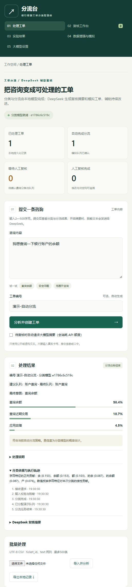
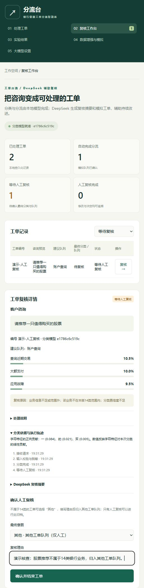
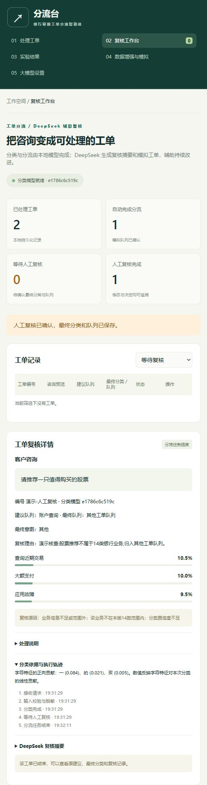
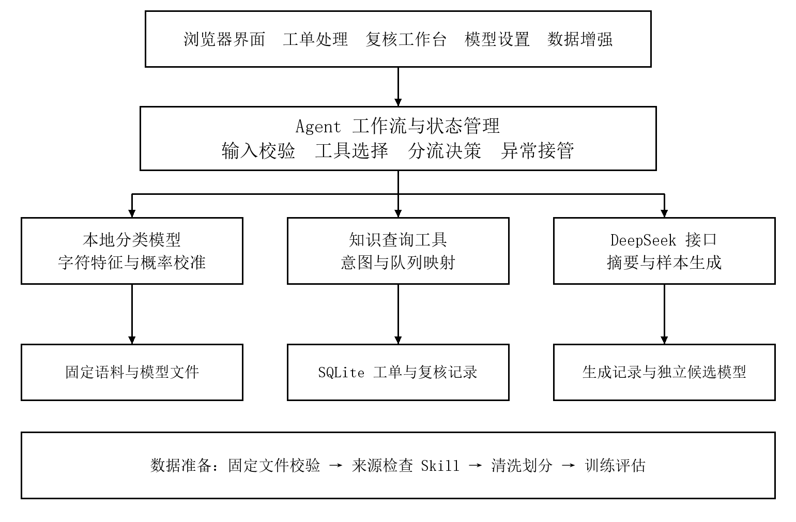
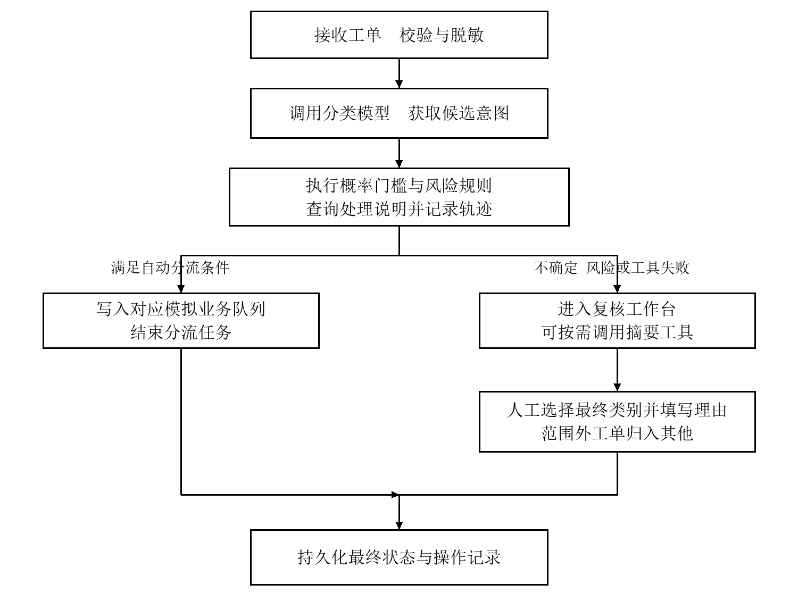
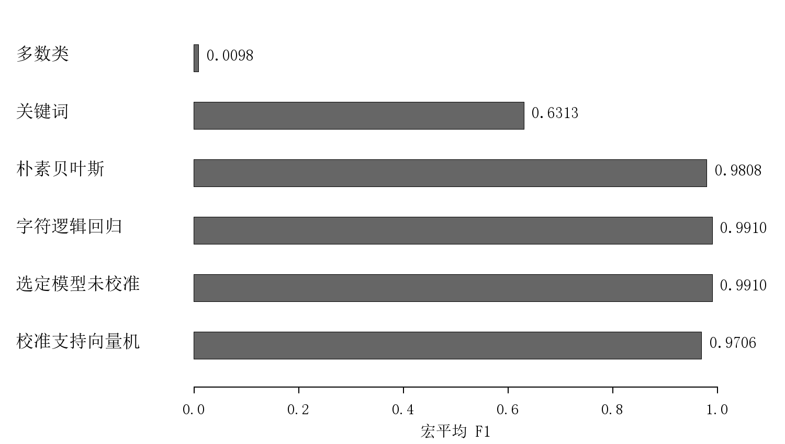
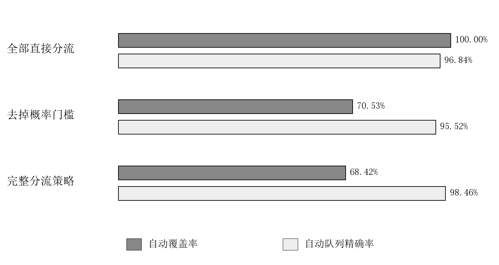

# 银行客服工单分流智能体

面向银行客服咨询的工单分流原型，结合本地分类模型与DeepSeek，完成业务识别、队列分流、复核摘要和训练数据增强。

[完整演示指南](DEMO.md) · [测试与证据矩阵](TEST_MATRIX.md) · [连续集成](.github/workflows/quality.yml)

## 功能

- **工单分流**：识别14类银行业务，显示候选意图、置信度、处理说明和执行轨迹。
- **人工复核**：在复核工作台选择最终分类、填写理由并确认；“其他”由人工归档。
- **工单摘要**：DeepSeek提取核心诉求、原文依据、待补充信息与复核建议。
- **数据增强**：按业务类别生成候选样本，去重后逐条审核，再训练独立候选模型并比较验证指标。
- **模拟与批量处理**：生成不同场景的模拟工单，支持CSV导入和结果导出。

## 界面预览

完整操作步骤、预期结果和 API 检查见[演示指南](DEMO.md)。

### 工单分类与分流



### 复核工作台



### 复核完成



### 系统架构与 Agent 工作流





### 模型与分流实验





## 安装与运行

环境：Python 3.12、Windows PowerShell。首次安装和下载数据需要网络。

```powershell
git clone https://github.com/Low-key-point/ticket-triage-agent.git
cd ticket-triage-agent
python -m venv .venv
.\.venv\Scripts\python.exe -m pip install -r requirements.txt
.\.venv\Scripts\python.exe -m triage.data
.\.venv\Scripts\python.exe -m triage.train
.\.venv\Scripts\python.exe -m triage.web
```

启动后在浏览器访问 **http://127.0.0.1:8765/** 。以后可直接运行：

```powershell
.\scripts\start.ps1
```

macOS或Linux将Python命令路径替换为`.venv/bin/python`，启动使用`python -m triage.web`。

## 演示步骤

1. **自动分流**：在“处理工单”输入“我想查询一下银行账户的余额”，点击“分析并创建工单”，查看意图与队列。
2. **人工复核**：提交“请推荐一只值得购买的股票”，进入“复核工作台”，选择“其他”并填写理由后确认。
3. **摘要生成**：进入“大模型设置”，填写自己的DeepSeek API密钥，保存并测试连接；打开一条工单，点击生成摘要，核对原文依据。
4. **生成与增强**：进入“数据增强与模拟”，选择一个类别、每类2条；生成后逐条审核，保留合适样本，再训练候选模型并查看对比结果。
5. **批量导入**：下载[示例工单CSV](demo/tickets.csv)，在处理工单页导入，完成后导出本地记录。

本地分类可直接使用；摘要和生成会调用DeepSeek官方接口并消耗API额度。密钥在本机页面填写，仅保存于服务端内存，8小时过期或服务重启后清除。演示使用公开或虚构文本。

## 模型与数据

本地模型采用字符TF-IDF与线性支持向量机，结合独立概率校准和分流策略。业务覆盖余额查询、地址修改、银行卡与应用故障、现金和支付等14类，另设人工专用的“其他”归档类别。

基础数据来自[PolyAI发布的MInDS-14](https://huggingface.co/datasets/PolyAI/minds14)的zh-CN子集，使用语音转写与意图标签。清洗后470条，固定划分为训练240、校准61、验证74、测试95条。模型训练脚本记录来源版本与文件哈希。

生成样本单独记录来源并经人工审核。训练增强沿用原校准集与验证集，候选模型独立保存。实验页展示基础模型的保留测试结果，增强页展示候选验证结果。

## 评估与测试

```powershell
.\.venv\Scripts\python.exe -m triage.evaluate
.\.venv\Scripts\python.exe -m triage.verify_skill
.\.venv\Scripts\python.exe -m triage.augmentation --replay demo/augmentation.json
.\.venv\Scripts\python.exe -m pytest -q
```

也可在安装依赖后运行`.\scripts\reproduce.ps1`，依次准备数据、核验数据来源、训练、评估、重做增强对照和测试。此命令使用已保存的28条合成样本重做候选训练，不会调用付费接口。生成新样本和新摘要需在页面配置自己的密钥。

`demo/augmentation.json`保存一次DeepSeek生成的28条样本及来源、调用量和核查方式；该批次经过AI辅助内容核查与审核界面确认，用于候选实验复验。重新调用生成接口会产生不同文本，效果以固定验证集比较为准。

当前 129 个自动化用例覆盖分类与分流边界、状态机、人工复核权限、全部公开路由、页面资源契约、HTTP 安全边界、DeepSeek 故障、摘要回滚、密钥生命周期、数据污染隔离、候选训练和复现材料。功能与断言映射见[测试与证据矩阵](TEST_MATRIX.md)。GitHub Actions在干净环境中重新执行数据准备、训练、评估、增强复放和测试，并保存实验报告构建产物。

## 数据来源检查 Skill

[数据来源检查 Skill](skills/dataset-source-check/SKILL.md)改编自Hugging Face Dataset Viewer的只读工作流，已接入`triage.data`。工具把数据来源和分页参数固定，检查行号、文本及标签，将前100条在线预览与已验SHA256的固定文件交叉核验。网络异常或预览变化单独记录，训练仍使用固定文件。`triage.verify_skill`补充5类错误响应验证。

运行后，`reports/`生成数据来源、模型版本、逐条预测、误差分析、策略对照及增强复验记录；`models/`保存本机训练产物。两者由脚本重建，不随仓库提交。

## 源码目录

| 路径 | 内容 |
| --- | --- |
| triage/ | 分类、分流策略、工单状态、DeepSeek接口、数据增强和模型训练 |
| web/ | 工单处理、复核、模型设置、数据增强与实验页面 |
| scripts/ | 启动与复现脚本 |
| demo/ | 实际运行截图与示例工单 |
| skills/ | 数据来源检查工作流、上游版本、权限和限制 |
| tests/ | 工单流程、接口、故障处理和数据隔离测试 |
| requirements.txt | 固定版本的运行与测试依赖 |

数据与第三方组件归属见[LICENSES.md](LICENSES.md)。
