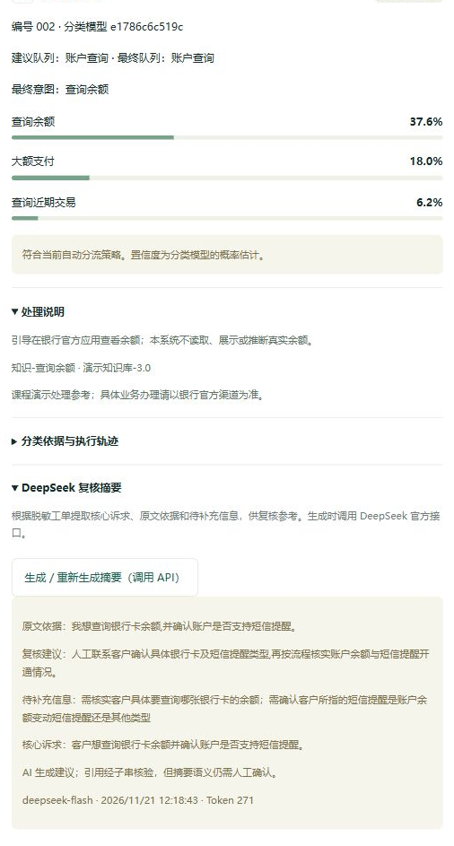
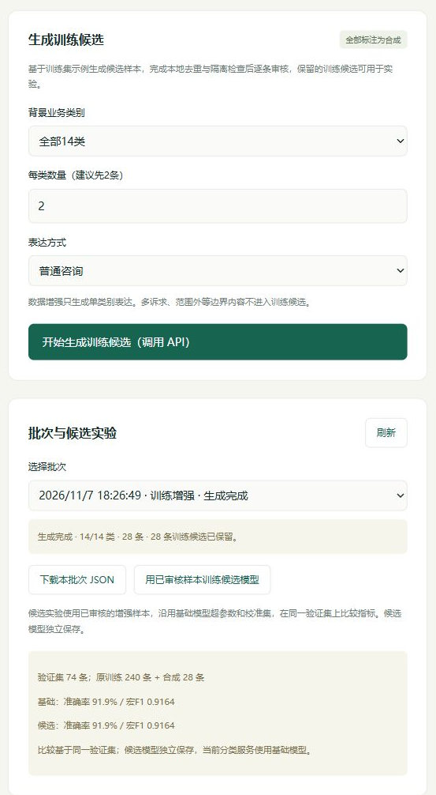

# DeepSeek 功能验收记录

验收日期：2026-11-21  
提供方：DeepSeek  
模型：`deepseek-flash`

## 实际连接

在本机“大模型设置”页面保存密钥后执行“测试实际连接”，返回“实际连接已通过”。

## 摘要生成

使用虚构咨询“我想查询银行卡余额，并确认账户是否支持短信提醒”创建工单 `002`，并实际调用 DeepSeek 生成摘要。

| 检查项 | 结果 |
| --- | --- |
| 核心诉求 | 客户想查询银行卡余额并确认账户是否支持短信提醒 |
| 原文依据 | 返回的引用可在输入原文中找到 |
| 待补充信息 | 账户信息、短信提醒功能范围 |
| 复核建议 | 人工核实身份后，分别处理余额与短信提醒诉求 |
| Token | 271 |
| 行为边界 | 摘要完成后仍保持原分类和自动分流状态 |

## 数据增强

数据增强页面仅提供训练候选生成。历史批次覆盖 14 类、共 28 条已审核训练候选。

| 检查项 | 结果 |
| --- | --- |
| 批次状态 | `completed` |
| 生成条数 | 28 |
| 提供方调用量 | 4254 Token |
| 人工审核 | 28 条训练候选已保留 |
| 基础模型验证 | 准确率 91.9%、宏 F1 0.9164 |
| 候选模型验证 | 准确率 91.9%、宏 F1 0.9164 |
| 模型状态 | 候选模型独立保存，当前服务继续使用基础模型 |
| 来源标记 | 大模型合成，非真实客户工单 |

## 行为核验

- 摘要引用通过原文子串核验。
- 摘要生成不修改分类、队列和关闭状态。
- 数据增强只生成训练候选，边界场景不进入训练。
- 候选训练沿用原校准集和验证集，且不会自动替换当前模型。
- API 密钥未写入验收记录、报告或 Git 仓库。

完整报告和身份信息保留在本地，本仓库只保留脱敏后的功能验收记录。
